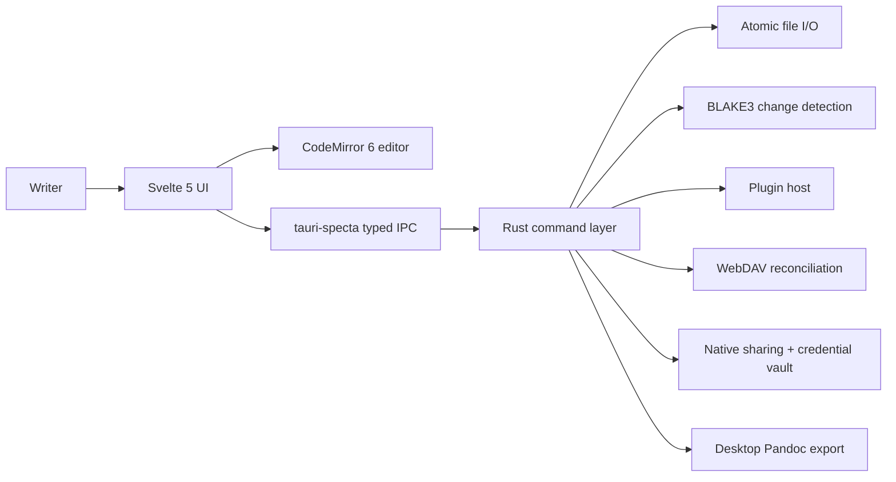

# Novelist Architecture

Last updated: 2026-10-28

Novelist is a local-first writing app with a shared Tauri v2 shell, Svelte 5
UI, and Rust service layer for desktop, Android, and iOS. Writing data stays
in plain files. CodeMirror 6 owns WYSIWYG Markdown editing; Rust owns atomic
file I/O, export, filesystem change detection, synchronization, and plugin
execution.

## Current Status

Source manifests currently use `0.6.1`; mobile adaptation does not itself
bump or publish a release. Android APK and iOS TestFlight distribution have
separate signing and validation gates; an initialized native project is not
evidence of an installed or approved release.

- Native project sources live under `core/gen/android/` and `core/gen/apple/`;
  machine paths, signing credentials, and build output are not committed.
- CI and release entry points live under `.github/workflows/` and `scripts/`.
- Core product features are implemented: WYSIWYG Markdown editor, project
  tree, tabs, split view, zen/focus flows, templates, snapshots, stats,
  export, settings overlay, native canvas/kanban file editors, and mindmap
  overlay.

## System Shape

## Load-Bearing Boundaries

- `app/lib/ipc/commands.ts` is generated by tauri-specta. Never edit it by
  hand.
- `app/lib/app-commands.ts` is the only command registration site.
- Svelte stores own UI state; services orchestrate IPC and avoid reactive
  ownership.
- CodeMirror owns editor state. Svelte wraps it and listens to derived
  signals.
- Rust owns filesystem access, atomic writes, watcher state, export, sync,
  and plugin execution.
- CJK behavior is product-critical, not an edge case.

## Mobile Platform Boundary

- `get_platform_capabilities` is the native authority for OS capabilities.
  `app/lib/stores/platform.svelte.ts` combines them with the live viewport
  for phone, tablet, and desktop layouts, including iPad window resizing.
  Unsupported desktop operations return an explicit error on mobile.
- Phone and tablet retain the same editing features. Drawers and panel sheets
  replace desktop chrome; external keyboard and touch actions share the
  command registry. Native input selection and IME composition stay with
  the editor and OS.
- `services/portable.rs` initializes private mobile app data separately from
  the project library. iOS exposes only `Documents/Projects` through Files;
  credentials and metadata remain private. Cache-staged imports and exports
  cross the sandbox boundary without treating Android `content://` URLs as
  filesystem paths.
- Mobile project persistence uses library-relative keys so iOS container
  relocation does not orphan recents, sync baselines, or snapshots. Canvas
  links within projects are relative to the project root.
- `core/plugins/tauri-plugin-mobile-support` implements native share sheets
  and Rust-only Keychain/Keystore credential access. Sharing grants access
  only to staged cache exports; iPad presentation has an anchored popover.
- `services/cloud.rs` connects a device to an existing WebDAV account.
  New-device downloads preserve project identity and reuse `services/sync.rs`
  three-way reconciliation. It is not a separate hosted account service;
  local writing remains account-free. TLS protects transport, not content
  from the chosen server administrator.

## Deep Dives

- Editor: [docs/design-docs/editor.md](docs/design-docs/editor.md)
- File lifecycle: [docs/design-docs/file-lifecycle.md](docs/design-docs/file-lifecycle.md)
- Plugin system: [docs/design-docs/plugin-system.md](docs/design-docs/plugin-system.md)
- Settings: [docs/design-docs/settings.md](docs/design-docs/settings.md)
- Testing: [docs/design-docs/testing.md](docs/design-docs/testing.md)
- Mobile deployment and accounts: [docs/design-docs/mobile-deployment.md](docs/design-docs/mobile-deployment.md)
- Feature boundaries: [docs/design-docs/feature-boundaries.md](docs/design-docs/feature-boundaries.md)
- Reliability: [docs/RELIABILITY.md](docs/RELIABILITY.md)
- Security: [docs/SECURITY.md](docs/SECURITY.md)
